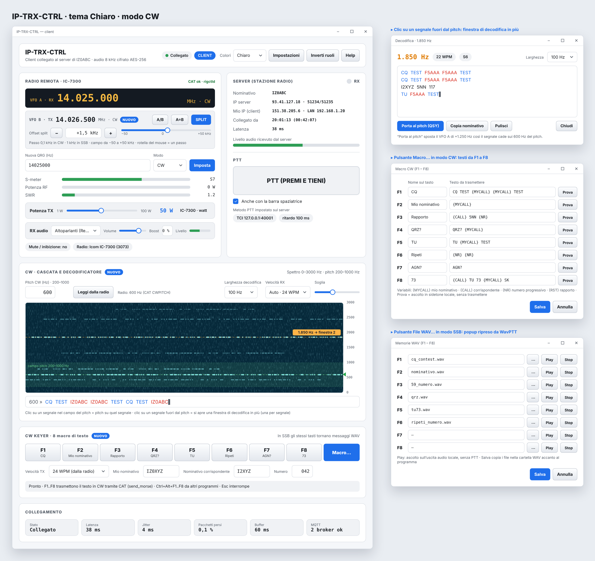

# IP-TRX-CTRL

IP-TRX-CTRL serve a usare una radio HF a distanza, via internet, come se fosse sul proprio tavolo. Un programma unico gira su due PC:

- **server**: il PC collegato alla radio (audio, CAT tramite Hamlib/rigctld, PTT);
- **client**: il PC dell'operatore, che riceve l'audio della radio, trasmette con il proprio microfono e comanda la radio.

I ruoli si scelgono al primo avvio e si possono invertire in qualsiasi momento.

> **Stato del progetto:** prima versione (0.1), compilata automaticamente ma non ancora provata con le radio. Le immagini sono bozzetti dell'interfaccia.

## In breve

- Audio bidirezionale sempre a **8 kHz, 16 bit mono**, cifrato AES-256.
- Porte, chiavi e riconnessioni gestite in automatico; il server viene ritrovato anche quando cambia indirizzo IP, tramite un broker MQTT pubblico.
- Controllo CAT della radio: frequenza, modo, VFO A/B con split, potenza TX, letture di S-meter, potenza e SWR.
- **Keyer** integrato sul client (deriva dal programma WavPTT): in SSB otto messaggi WAV su F1…F8, in CW otto macro di testo trasmesse dalla radio.
- In modo CW: cascata 0–3000 Hz, decodificatore sul pitch e finestre di decodifica aggiuntive per gli altri segnali.
- Sei temi di colore: Chiaro, Notte, Nero, Blu, Viola, Verde.
- Un unico codice sorgente per **Windows 64 bit, Windows 32 bit, macOS, Linux e Raspberry Pi**.

