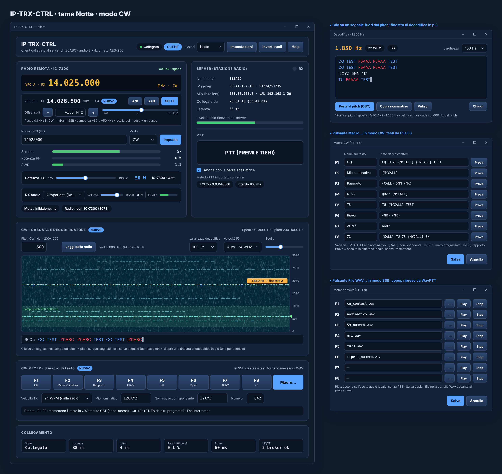

# Modo CW

Quando la radio è in un modo CW, al posto del riquadro audio compare **CW · cascata e decodificatore**. Microfono e audio TX sono nascosti; l'audio di ricezione si sposta su una riga nel riquadro *Radio remota*.

## Cascata

- Spettro dell'audio ricevuto da **0 a 2000 Hz** (frequenza in verticale, tempo in orizzontale).
- La fascia del pitch (200–1000 Hz) è evidenziata; una linea verde segna il pitch in uso.
- **Scala a destra**: scostamento dal pitch in Hz, con **000** sulla linea del pitch (e la freccia verde), +/− sopra e sotto.
- **Scala a sinistra**: la **QRG reale** di ogni segnale (MHz.kHz.Hz), calcolata dalla frequenza della radio e dal pitch: in CW un segnale più acuto sta sopra la QRG della radio, in CW-R sotto. Senza la frequenza della radio la scala a sinistra mostra i Hz audio.
- Passando il mouse sulla cascata compare la QRG precisa e lo scostamento dal pitch del punto indicato.
- Dalla 0.2.5 scorre 3 volte più veloce: una nuova colonna ogni 21 ms circa (47 al secondo), circa 14 secondi di storia sulla larghezza della cascata. Ogni colonna analizza 64 ms di audio, così punti e linee del CW si vedono separati.

## Pitch

- Casella **Pitch CW (Hz)** da **200 a 1000 Hz**.
- Il server legge il pitch impostato sulla radio (livello Hamlib `CWPITCH`) e lo propone nella casella; **Leggi dalla radio** lo rilegge. Se si cambia la casella, il pitch viene reimpostato anche sulla radio. Se la radio non supporta il comando, vale il valore scritto a mano.

## Decodificatore

- Lavora sull'audio ricevuto a 8 kHz.
- Filtro stretto centrato sul pitch (larghezza scelta da 50 a 200 Hz), soglia adattiva sul rumore, misura di punti, linee e pause, riconoscimento automatico della velocità da 5 a 60 WPM.
- Il testo del segnale sul pitch scorre nella riga sotto la cascata, con i nominativi evidenziati.
- È scritto da zero, senza codice di altri decodificatori.

## Altri segnali

- Clic su un segnale **dentro** la fascia del pitch: il pitch si sposta su quel segnale.
- Clic su un segnale **fuori** dal pitch: si apre una **finestra di decodifica in più**, una per ogni segnale. La finestra mostra frequenza, velocità e testo, con i pulsanti **Porta al pitch (QSY)** (sposta il VFO perché il segnale cada sul pitch), **Copia nominativo**, **Pulisci** e **Chiudi**.

## Filtro della radio e intensità della cascata

Con il filtro CW stretto della radio (di solito 500 Hz o meno) la cascata orizzontale resta quasi vuota: la radio taglia tutto quello che sta fuori dal filtro. Per questo, quando si entra in CW, IP-TRX-CTRL chiede alla radio un **filtro largo** (3000 Hz di serie; si può scegliere 1200, 2400, 2700, 3000 o 3600 Hz) con il comando Hamlib della larghezza di banda. Il filtro attuale letto dalla radio compare accanto alla scelta. Togliendo la spunta «Filtro largo» si torna al filtro normale della radio.

Il cursore **Intensità** sposta la scala dei colori della cascata: verso sinistra il rumore diventa più scuro e i segnali risaltano, verso destra si vedono anche i segnali più deboli.
