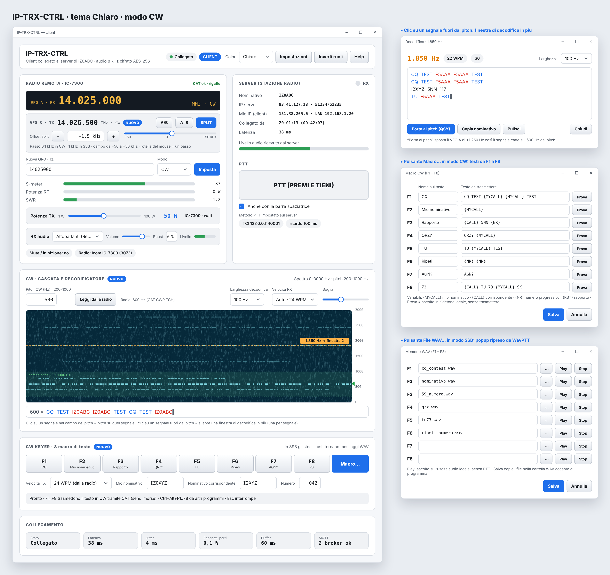
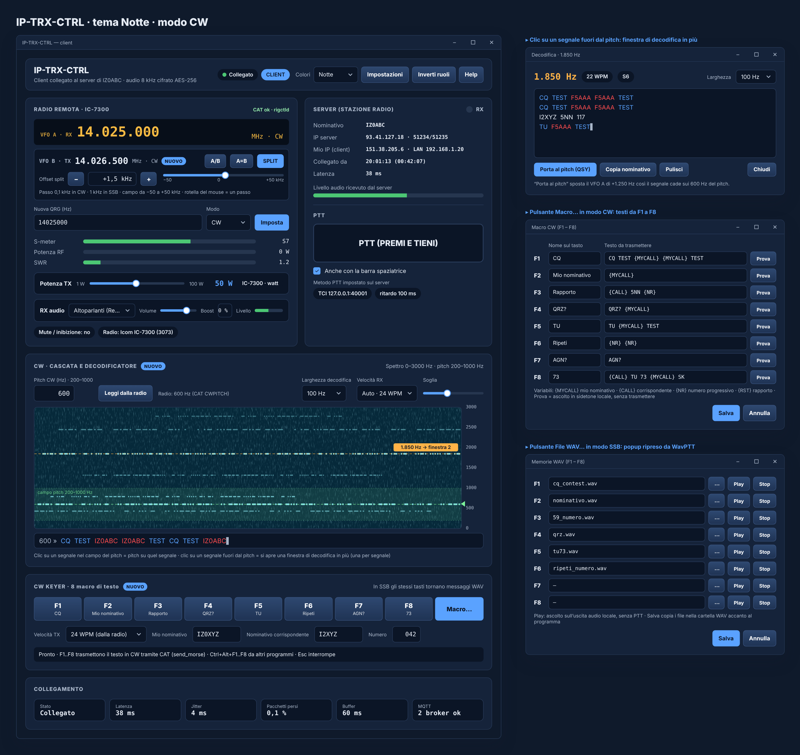
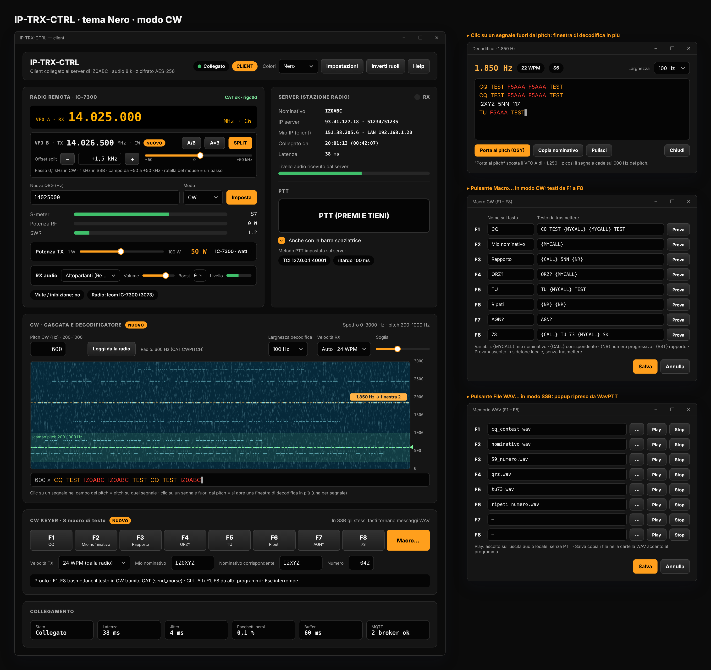
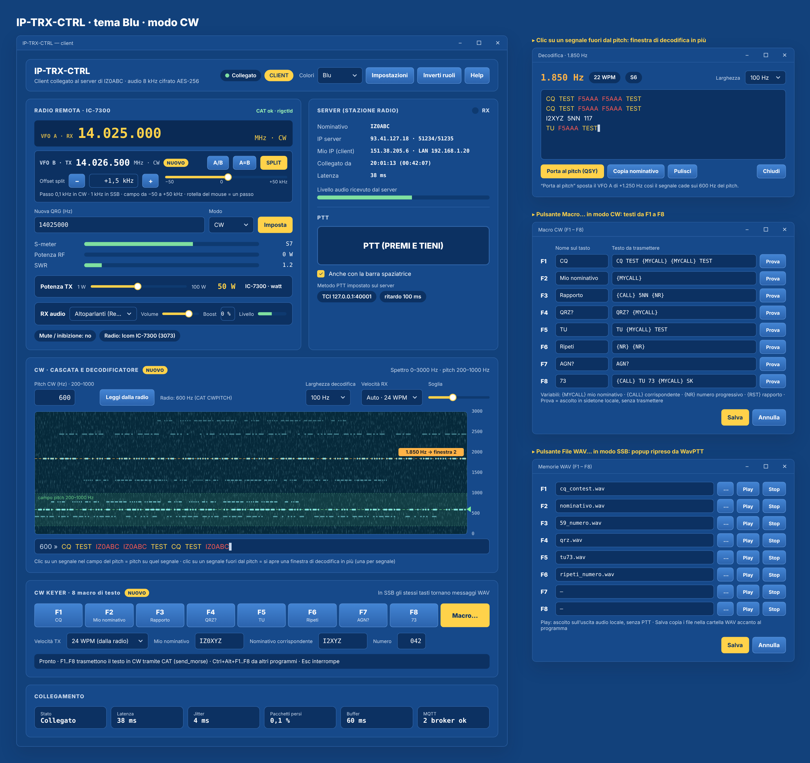
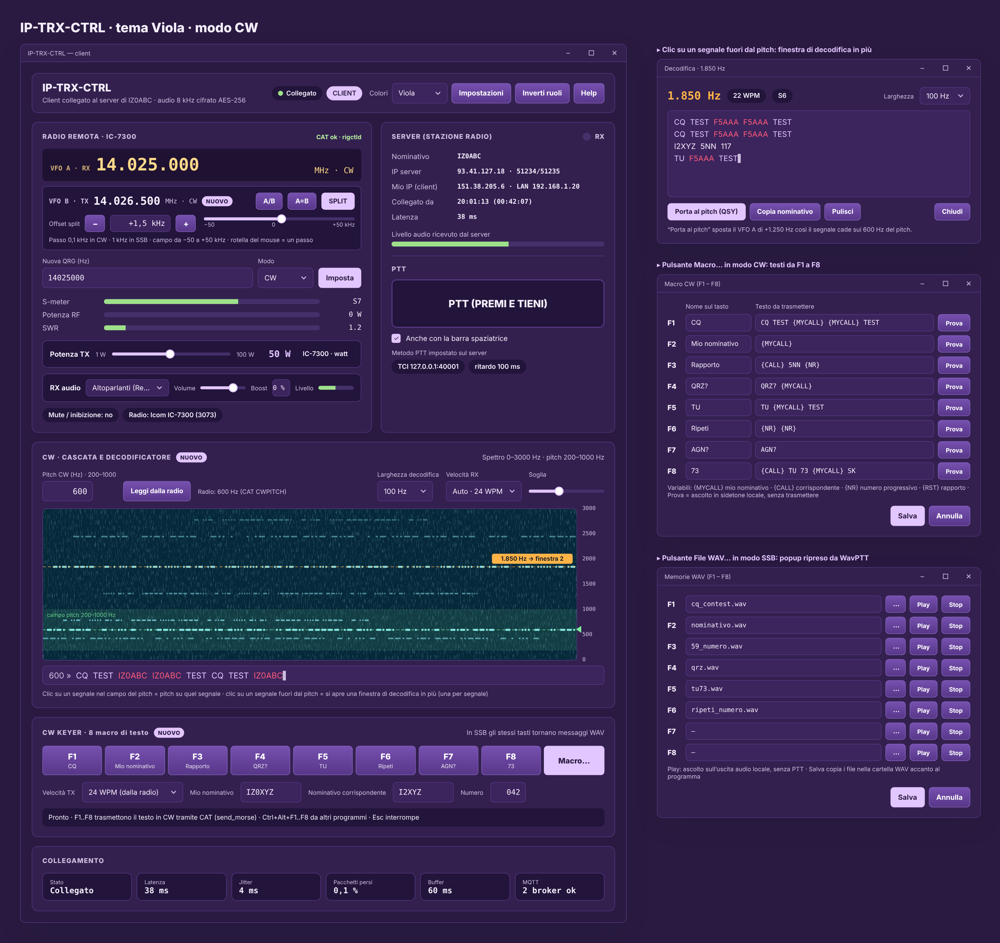
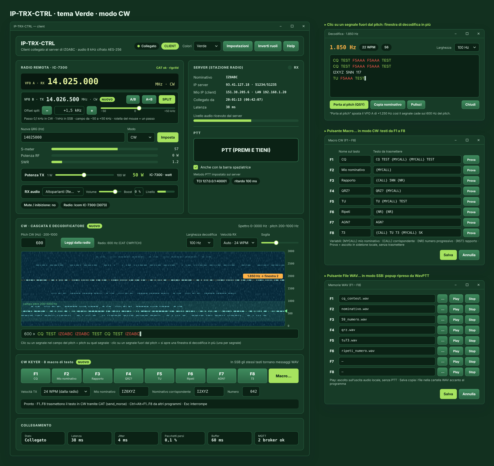

# Temi di colore

Diciotto temi, scelti dal menu **Colori** in alto nella finestra principale: gli stessi di E-LAYER ANALYZER e degli altri programmi di IC8TEM (armonizzazione del 15/11/2026, in preparazione sul ramo «armonizzazione»).

Nel menu, in quest'ordine: Chiaro, Notte e Nero di YA-MS; otto pastelli (azzurro, arancio, acquamarina, verde, rosa, lilla, indaco, marrone), con le tinte di YAEC; Scia meteorica; poi i sei temi originali di IP-TRX-CTRL qui sotto. Il tema già scelto resta quello. Le immagini sono bozzetti in modo CW dei sei temi originali.

## Chiaro

## Notte

## Nero

## Blu

## Viola

## Verde

