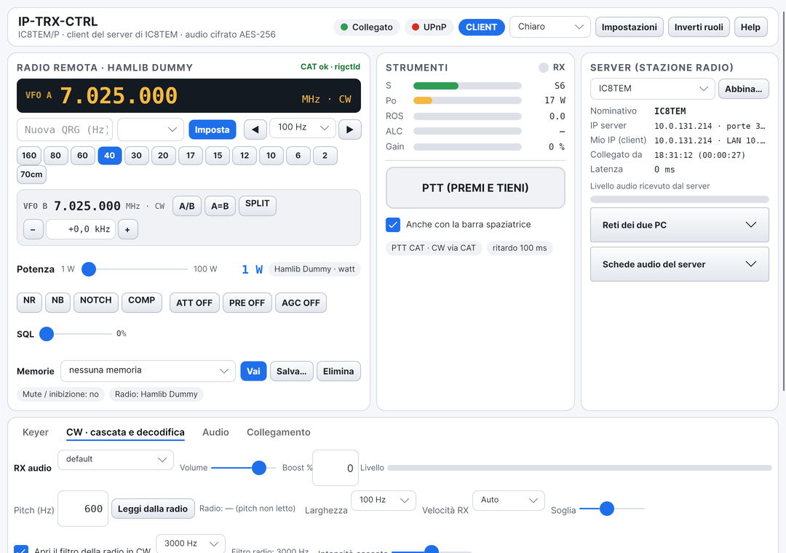

# CW-Betrieb

Ist das Gerät in einer CW-Betriebsart, erscheint statt des Audio-Bereichs **CW · cascata e decodificatore** (CW · Wasserfall und Decoder). Mikrofon und Sendeaudio sind ausgeblendet; das Empfangsaudio wandert in eine Zeile im Bereich *Radio remota* (entferntes Funkgerät).

## Wasserfall

- Spektrum des empfangenen Audios von **0 bis 2000 Hz** (Frequenz senkrecht, Zeit waagerecht).
- Der Pitch-Bereich (200–1000 Hz) ist hervorgehoben; der aktuelle Pitch ist mit dem grünen Pfeil und der **000** auf der rechten Skala markiert (seit 0.2.6 ohne gestrichelte Linie im Wasserfall, um keine Signale zu verdecken).
- **Rechte Skala**: Ablage vom Pitch in Hz, mit **000** auf Höhe des Pitch (und dem grünen Pfeil), +/− darüber und darunter.
- **Linke Skala**: die **echte Frequenz** jedes Signals (MHz.kHz.Hz), berechnet aus der Gerätefrequenz und dem Pitch: in CW liegt ein höheres Signal über der Gerätefrequenz, in CW-R darunter. Ohne Gerätefrequenz zeigt die linke Skala Audio-Hz.
- Fährt man mit der Maus über den Wasserfall, erscheinen die genaue Frequenz und die Ablage vom Pitch des Punktes.
- Seit 0.2.5 läuft er dreimal so schnell: eine neue Spalte etwa alle 21 ms (47 pro Sekunde), rund 14 Sekunden Verlauf über die Breite des Wasserfalls. Jede Spalte analysiert 64 ms Audio, so dass Punkte und Striche getrennt zu sehen sind.

## Pitch

- Feld **Pitch CW (Hz)** von **200 bis 1000 Hz**.
- Der Server liest den am Gerät eingestellten Pitch (Hamlib-Level `CWPITCH`) und trägt ihn ins Feld ein; **Leggi dalla radio** (vom Gerät lesen) liest ihn neu. Ändert man das Feld, wird der Pitch auch am Gerät gesetzt. Unterstützt das Gerät den Befehl nicht, gilt der von Hand eingegebene Wert.

## Decoder

- Er arbeitet mit dem empfangenen Audio bei 8 kHz.
- Schmales Filter auf dem Pitch (Breite wählbar von 50 bis 200 Hz), adaptive Schwelle über dem Rauschen, Messung von Punkten, Strichen und Pausen, automatische Geschwindigkeitserkennung von 5 bis 60 WPM.
- Der Text des Signals auf dem Pitch läuft in der Zeile unter dem Wasserfall, Rufzeichen hervorgehoben.
- Er ist von Grund auf neu geschrieben, ohne Code anderer Decoder.

## Andere Signale

- Klick auf ein Signal **innerhalb** des Pitch-Bereichs: der Pitch springt auf dieses Signal.
- Klick auf ein Signal **außerhalb** des Pitch: ein **zusätzliches Decoderfenster** öffnet sich, eines pro Signal. Es zeigt Frequenz, Geschwindigkeit und Text, mit den Tasten **Porta al pitch (QSY)** (VFO so verschieben, dass das Signal auf den Pitch fällt), **Copia nominativo** (Rufzeichen kopieren), **Pulisci** (leeren) und **Chiudi** (schließen).

## Gerätefilter und Intensität des Wasserfalls

Mit dem schmalen CW-Filter des Geräts (meist 500 Hz oder weniger) bleibt der waagerechte Wasserfall fast leer: das Gerät schneidet alles außerhalb des Filters ab. Deshalb fordert IP-TRX-CTRL beim Wechsel auf CW ein **breites Filter** an (standardmäßig 3000 Hz; wählbar 1200, 2400, 2700, 3000 oder 3600 Hz), mit dem Hamlib-Befehl für die Bandbreite. Das aktuell vom Gerät gelesene Filter steht neben der Auswahl. Entfernt man den Haken bei «Filtro largo» (breites Filter), gilt wieder das normale Gerätefilter.

Der Regler **Intensità** (Intensität) verschiebt die Farbskala des Wasserfalls: nach links wird das Rauschen dunkler und Signale treten hervor, nach rechts sieht man auch die schwächsten Signale.

---

[Inhalt](Deutsch) · Andere Sprachen: [Italiano](IT-Modo-CW) · [English](EN-CW-mode) · [Español](ES-Modo-CW) · [Français](FR-Mode-CW)
