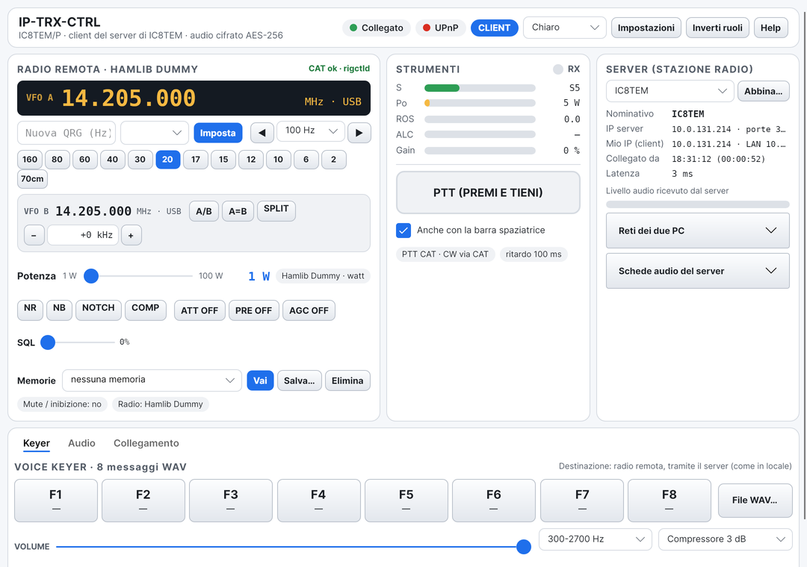
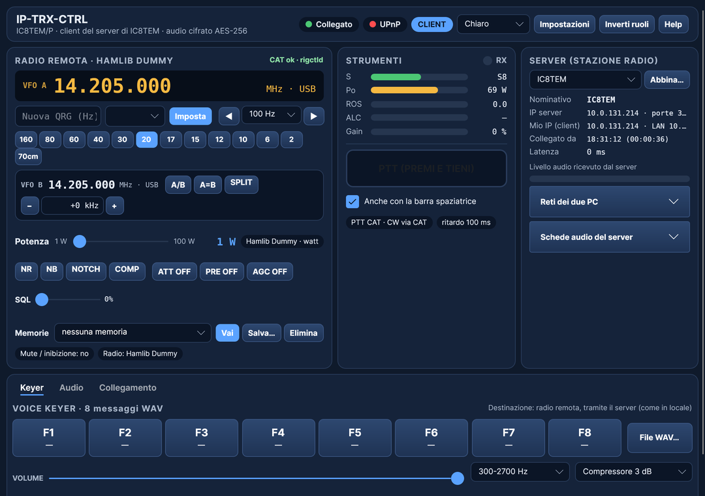
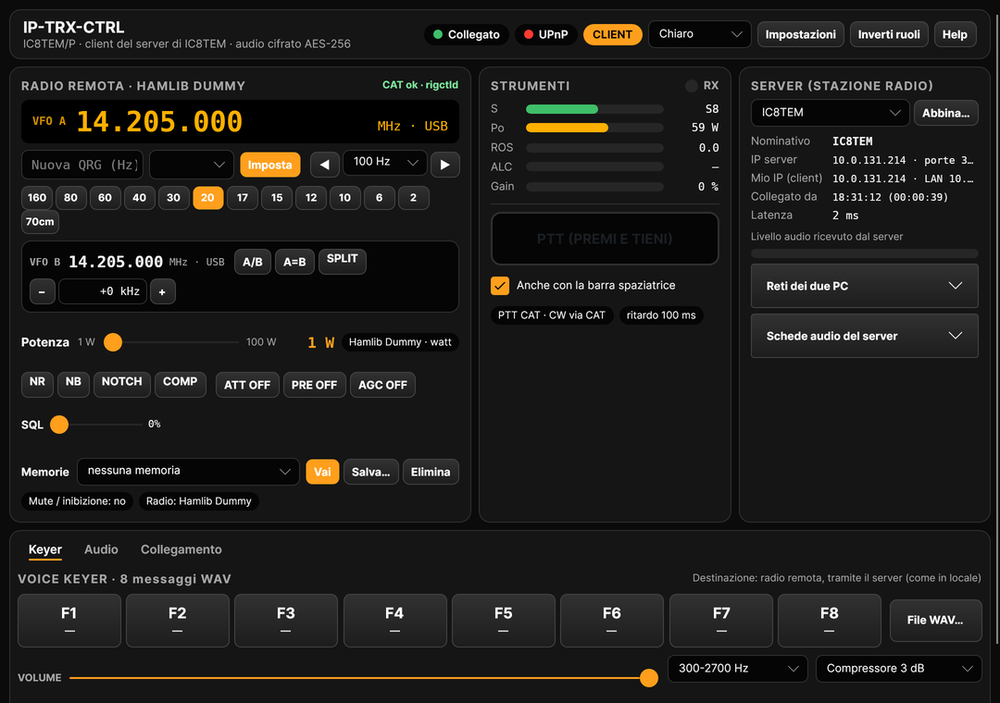
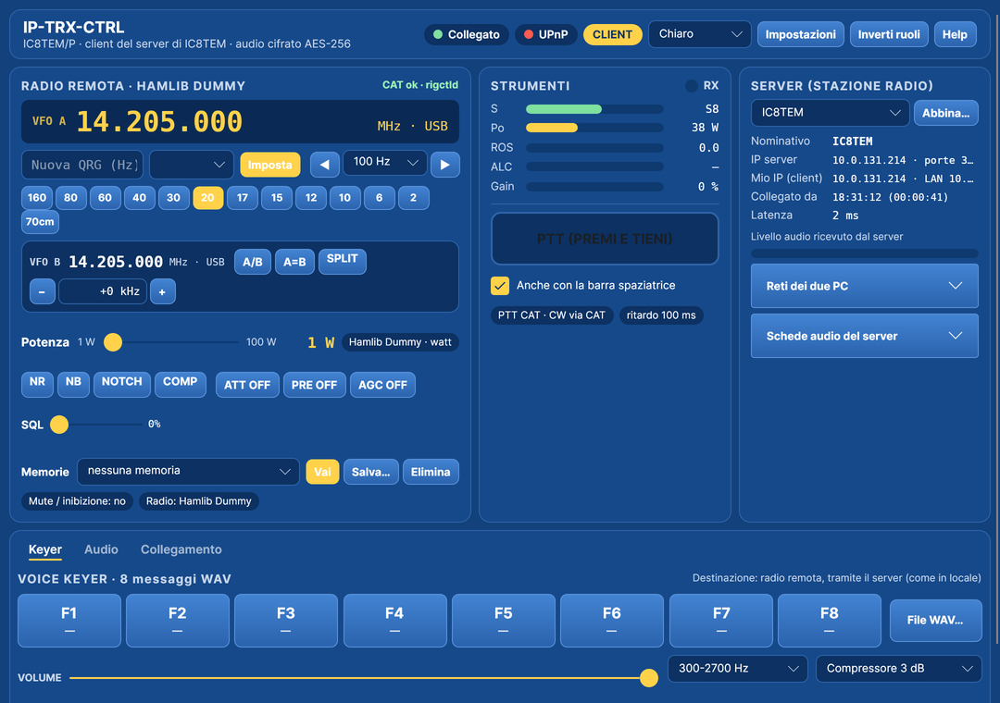
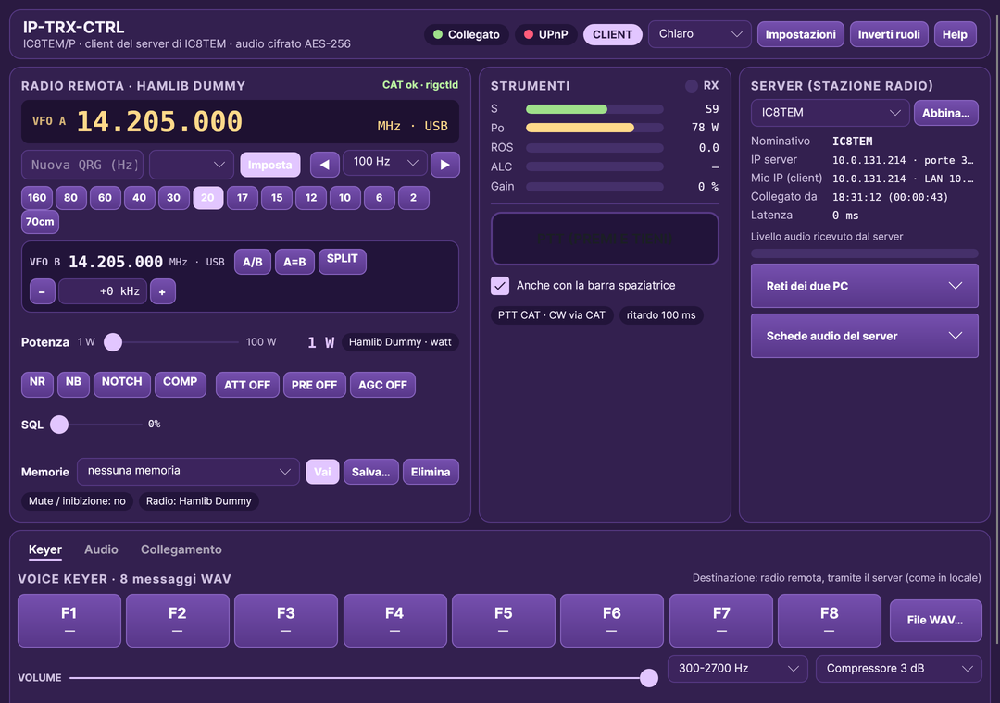
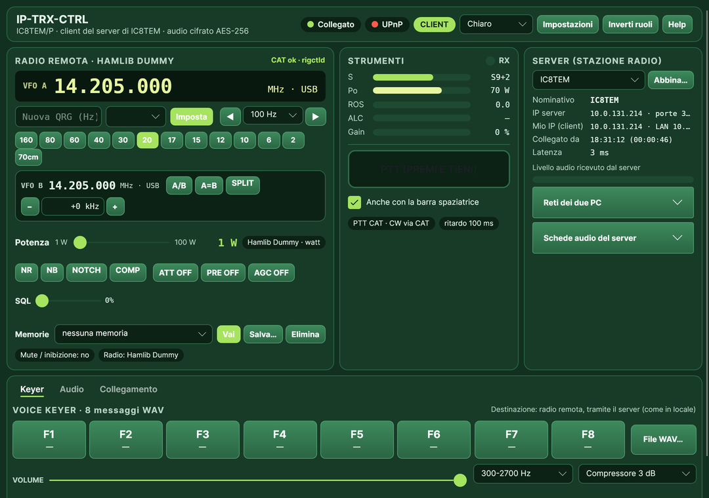

# Farbthemen

Sechs Themen, gewählt im Farbmenü oben im Hauptfenster. Die Bilder sind echte Aufnahmen des mit einem Server verbundenen Clients.

## Chiaro (hell)

## Notte (Nacht)

## Nero (schwarz)

## Blu (blau)

## Viola (violett)

## Verde (grün)

---

[Inhalt](Deutsch) · Andere Sprachen: [Italiano](IT-Temi-di-colore) · [English](EN-Colour-themes) · [Español](ES-Temas-de-color) · [Français](FR-Thèmes-de-couleur)
