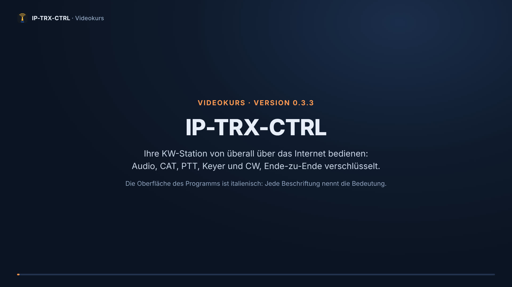

# Videokurs

Ein Videokurs von etwa 13 Minuten über IP-TRX-CTRL **0.3.3**, mit echten Aufnahmen des Programms: ein Server und ein Client, über das Internet gekoppelt, ein simuliertes Funkgerät (Hamlib Dummy) und die Browserseite. Deutsche Untertitel, ohne Sprecher. Die Oberfläche des Programms ist italienisch: die Untertitel nennen die Bedeutung jeder Beschriftung.

**[Video herunterladen (MP4, 1920×1080)](https://raw.githubusercontent.com/ic8tem/IP-TRX-CTRL/video-corso/IP-TRX-CTRL-video-course-de.mp4)**

## Kapitel

| Zeit | Kapitel |
|---|---|
| 0:15 | So funktioniert es |
| 1:08 | Herunterladen und installieren |
| 1:57 | Erster Start |
| 3:04 | Den Server einrichten |
| 4:40 | Die beiden PCs koppeln |
| 5:53 | Das Client-Fenster |
| 7:55 | Sicher senden |
| 9:00 | Sprach-Keyer und CW |
| 10:05 | Im Browser oder am Telefon |
| 11:10 | Nach Maß |
| 11:42 | Updates und Hilfe |

Derselbe Kurs in anderen Sprachen: [Italiano](IT-Video-corso) · [English](EN-Video-course) · [Español](ES-Videocurso) · [Français](FR-Cours-vidéo)

---

[Inhalt](Deutsch) · Andere Sprachen: [Italiano](IT-Video-corso) · [English](EN-Video-course) · [Español](ES-Videocurso) · [Français](FR-Cours-vidéo)
