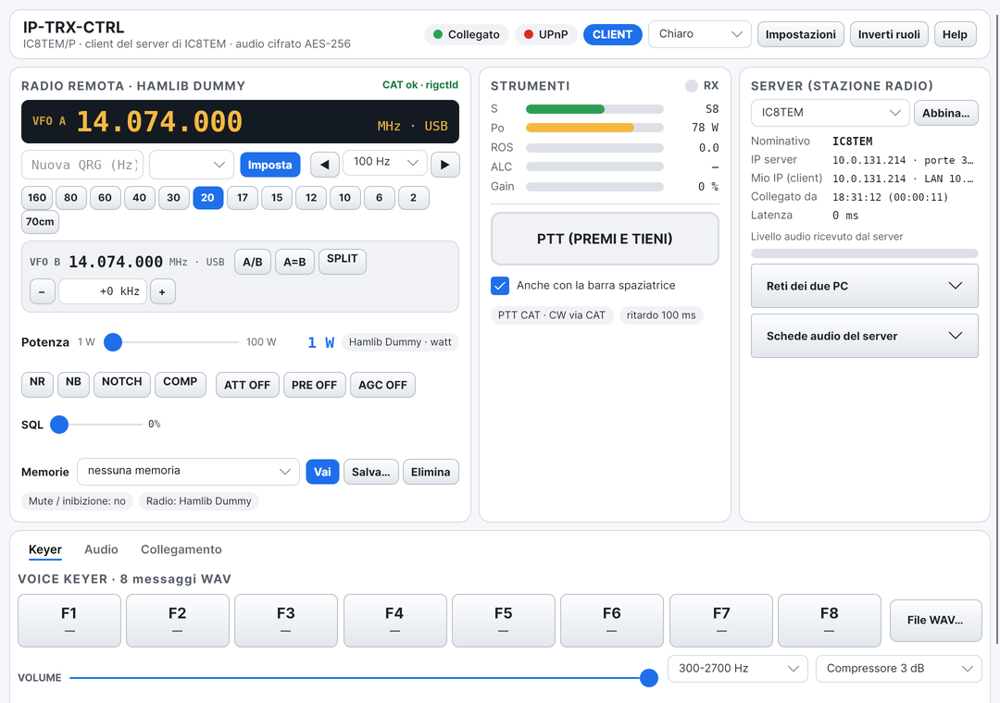

# IP-TRX-CTRL

Mit IP-TRX-CTRL bedient man ein KW-Funkgerät aus der Ferne über das Internet, als stünde es auf dem eigenen Tisch. Ein einziges Programm läuft auf zwei PCs:

- **Server**: der PC am Funkgerät (Audio, CAT über Hamlib/rigctld, PTT);
- **Client**: der PC des Operators, der das Audio des Geräts empfängt, mit dem eigenen Mikrofon sendet und das Gerät steuert.

Die Rollen werden beim ersten Start gewählt und lassen sich jederzeit tauschen.

> **Aktuelle Version: 0.3.4.** Die Bilder sind echte Aufnahmen des Programms (ein Client verbunden mit einem Server, Funkgerät von Hamlib simuliert). Die Oberfläche des Programms ist italienisch: diese Seiten nennen die Bedeutung jeder Beschriftung.

## Kurz gesagt

- Audio in beide Richtungen immer mit **8 kHz, 16 Bit mono**, verschlüsselt mit AES-256.
- Ports, Schlüssel und Wiederverbindungen automatisch; der Server wird auch nach einem IP-Wechsel über einen öffentlichen MQTT-Broker wiedergefunden.
- CAT-Steuerung des Geräts: Frequenz, Betriebsart, VFO A/B mit Split, Sendeleistung, Anzeige von S-Meter, Leistung und SWR, SWR-Schutz mit Sendesperre.
- **Keyer** im Client (abgeleitet vom Programm WavPTT): in SSB acht WAV-Meldungen auf F1…F8, in CW acht Textmakros, die das Gerät sendet.
- Im CW-Betrieb: Wasserfall 0–2000 Hz mit der echten Frequenz der Signale, Decoder auf dem Pitch und zusätzliche Decoderfenster für andere Signale.
- Digitalprogramme am Client (WSJT-X, JTDX, fldigi…) über einen lokalen rigctld und virtuelle Audiokabel: siehe [Digitalbetrieb, PTT-Pedal und CW-Taste](DE-Digitalbetrieb-und-Pedal).
- PTT-Pedal und mechanische CW-Taste an einer seriellen Schnittstelle des Clients.
- Port-Zyklus zwischen Server und Client (UPnP von außen geprüft, umgekehrte Verbindung, 20 Runden) und Audio über UDP, wenn möglich: siehe [Ports und Verbindung](DE-Ports-und-Verbindung).
- Seit 0.3.0: Sicherheit beim Senden (Maximalzeit, keine Frequenzwechsel beim Senden, Vorrang für den Operator am Gerät, Clients nur mit Empfang), Gerätebedienung (NR, NB, Notch, ATT, Vorverstärker, AGC, Kompressor, Squelch, ALC), Bänder, Schritt und Speicher, der [Panadapter des Funkgeräts](DE-Panadapter), Problembericht und Hinweis auf neue Versionen. Siehe [Funkgerät, Split und Leistung](DE-Funkgerät-Split-und-Leistung) und [Hauptfenster](DE-Hauptfenster).
- Seit 0.3.1: [Zugriff über den Browser](DE-Zugriff-über-den-Browser) von Telefon, Tablet und PC, mit der Seite «Trova il server» (Server finden).
- Seit 0.3.2: automatische Updates (nicht für die Pakete .deb, .rpm, Arch und Slackware) und Pakete für Windows ARM, Fedora/openSUSE, Arch, Slackware, AppImage und Alpine: siehe [Protokolle und Fehlersuche](DE-Protokolle-und-Fehlersuche).
- Seit 0.3.4: selbst gewählte Ports in den Einstellungen (mit der Liste der beiden zu öffnenden Ports); doppeltes NAT und UPnP von einem Gerät, das nicht der Router ist, werden erkannt.
- Seit 0.3.3: unter Linux, Raspberry Pi und Mac hängen Ersteinrichtung, Einstellungen und Lizenzen nicht mehr; Beschriftungen SWR und Gain sichtbar.
- Sechs Farbthemen: Chiaro, Notte, Nero, Blu, Viola, Verde (hell, Nacht, schwarz, blau, violett, grün): siehe [Farbthemen](DE-Farbthemen).
- Ein einziger Quellcode für **Windows 64 Bit, 32 Bit und ARM, macOS, Linux (auch Alpine) und Raspberry Pi**.

Vor dem Aktualisieren eines der beiden PCs die [kompatiblen Versionen](DE-Kompatible-Versionen) ansehen.

## Seiten

- [Videokurs](DE-Videokurs)
- [Hauptfenster](DE-Hauptfenster)
- [Kopplung und MQTT](DE-Kopplung-und-MQTT)
- [Ports und Verbindung](DE-Ports-und-Verbindung)
- [Funkgerät, Split und Leistung](DE-Funkgerät-Split-und-Leistung)
- [Audio und Soundkarten des Servers](DE-Audio-und-Soundkarten-des-Servers)
- [Keyer, WAV-Meldungen und CW-Makros](DE-Keyer-WAV-Meldungen-und-CW-Makros)
- [CW-Betrieb](DE-CW-Betrieb)
- [Panadapter](DE-Panadapter)
- [Digitalbetrieb und Pedal](DE-Digitalbetrieb-und-Pedal)
- [TCI-Verbindung](DE-TCI-Verbindung)
- [Zugriff über den Browser](DE-Zugriff-über-den-Browser)
- [Farbthemen](DE-Farbthemen)
- [Protokolle und Fehlersuche](DE-Protokolle-und-Fehlersuche)
- [Kompatible Versionen](DE-Kompatible-Versionen)
- [Plattformen und Kompilierung](DE-Plattformen-und-Kompilierung)
- [Lizenzen](DE-Lizenzen)

---

[Inhalt](Deutsch) · Andere Sprachen: [Italiano](Italiano) · [English](English) · [Español](Español) · [Français](Français)
