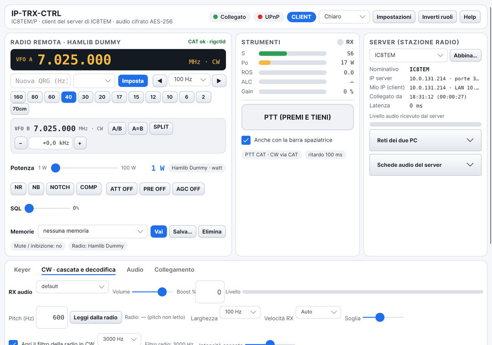

# CW mode

When the radio is in a CW mode, **CW · cascata e decodificatore** (CW · waterfall and decoder) appears in place of the audio box. Microphone and TX audio are hidden; receive audio moves to one line in the *Radio remota* (remote radio) box.

## Waterfall

- Spectrum of the received audio from **0 to 2000 Hz** (frequency vertical, time horizontal).
- The pitch band (200–1000 Hz) is highlighted; the pitch in use is marked by the green arrow and by **000** on the right-hand scale (since 0.2.6 without a dashed line on the waterfall, so as not to cover signals).
- **Right-hand scale**: offset from the pitch in Hz, with **000** at the pitch (and the green arrow), +/− above and below.
- **Left-hand scale**: the **real frequency** of each signal (MHz.kHz.Hz), computed from the radio's frequency and the pitch: in CW a higher-pitched signal sits above the radio's frequency, in CW-R below. Without the radio's frequency the left scale shows audio Hz.
- Moving the mouse over the waterfall shows the exact frequency and the offset from the pitch of the point under it.
- Since 0.2.5 it scrolls 3 times faster: a new column about every 21 ms (47 per second), about 14 seconds of history across the waterfall's width. Each column analyses 64 ms of audio, so CW dots and dashes are seen separately.

## Pitch

- **Pitch CW (Hz)** box from **200 to 1000 Hz**.
- The server reads the pitch set on the radio (Hamlib level `CWPITCH`) and puts it in the box; **Leggi dalla radio** (read from the radio) reads it again. If you change the box, the pitch is also set on the radio. If the radio does not support the command, the value typed by hand applies.

## Decoder

- It works on the received audio at 8 kHz.
- Narrow filter centred on the pitch (width chosen from 50 to 200 Hz), adaptive threshold over the noise, measurement of dots, dashes and gaps, automatic speed detection from 5 to 60 WPM.
- The text of the signal on the pitch scrolls in the line below the waterfall, with callsigns highlighted.
- It is written from scratch, with no code from other decoders.

## Other signals

- Click on a signal **inside** the pitch band: the pitch moves to that signal.
- Click on a signal **outside** the pitch: an **extra decoding window** opens, one for each signal. It shows frequency, speed and text, with the buttons **Porta al pitch (QSY)** (move the VFO so the signal falls on the pitch), **Copia nominativo** (copy callsign), **Pulisci** (clear) and **Chiudi** (close).

## Radio filter and waterfall intensity

With the radio's narrow CW filter (usually 500 Hz or less) the horizontal waterfall stays almost empty: the radio cuts everything outside the filter. So when entering CW, IP-TRX-CTRL asks the radio for a **wide filter** (3000 Hz by default; you can choose 1200, 2400, 2700, 3000 or 3600 Hz) with the Hamlib bandwidth command. The current filter read from the radio is shown next to the choice. Unticking «Filtro largo» (wide filter) returns to the radio's normal filter.

The **Intensità** (intensity) slider shifts the waterfall's colour scale: to the left the noise gets darker and signals stand out, to the right even the weakest signals show.

---

[Contents](English) · Other languages: [Italiano](IT-Modo-CW) · [Español](ES-Modo-CW) · [Français](FR-Mode-CW) · [Deutsch](DE-CW-Betrieb)
