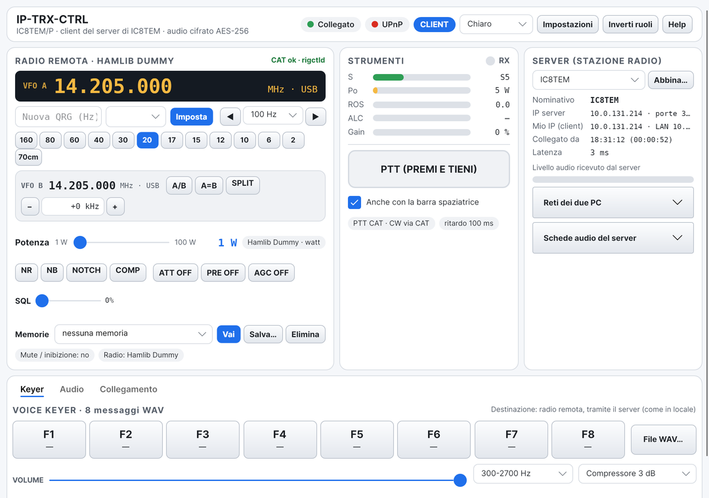
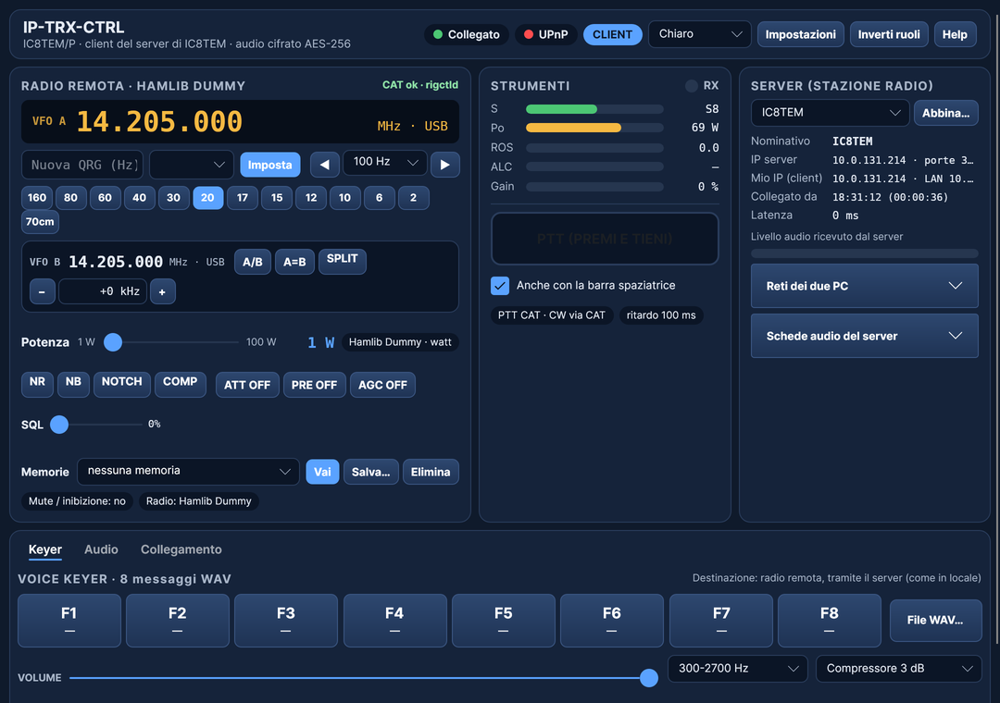
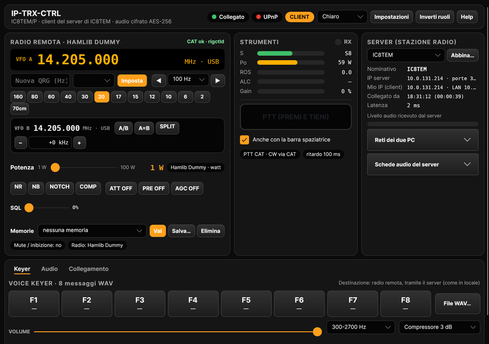
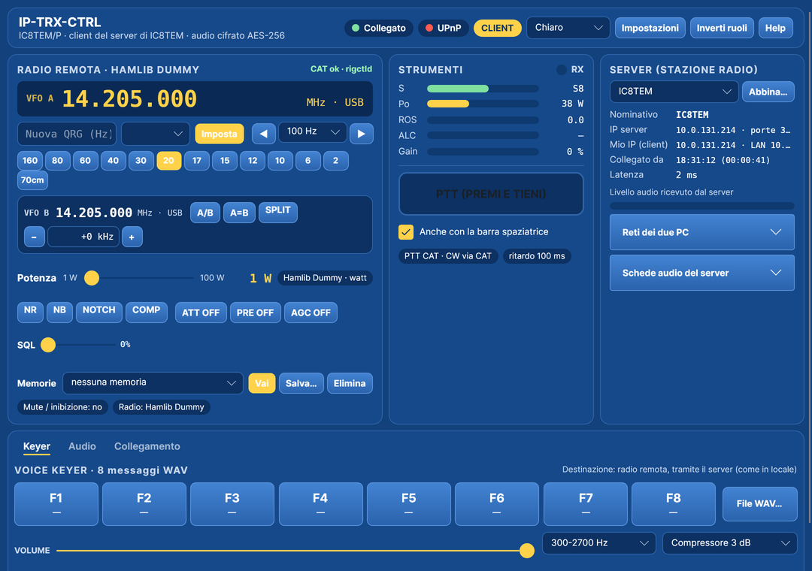
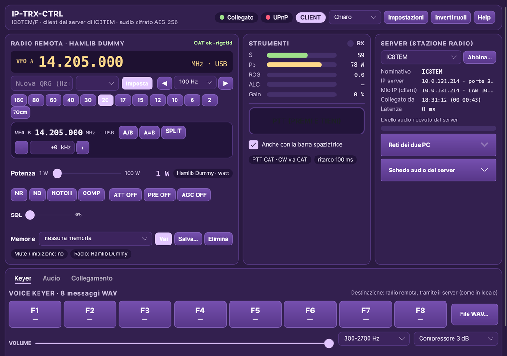
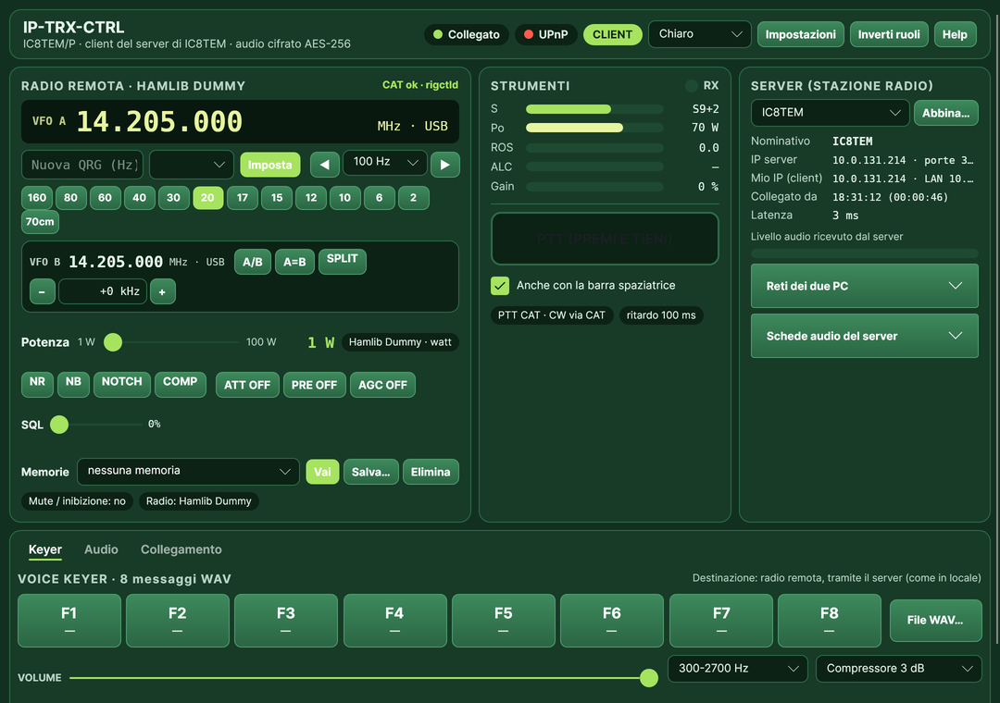

# Colour themes

Six themes, chosen from the colour drop-down at the top of the main window. The pictures are real screenshots of the client connected to a server.

## Chiaro (light)

## Notte (night)

## Nero (black)

## Blu (blue)

## Viola (violet)

## Verde (green)

---

[Contents](English) · Other languages: [Italiano](IT-Temi-di-colore) · [Español](ES-Temas-de-color) · [Français](FR-Thèmes-de-couleur) · [Deutsch](DE-Farbthemen)
