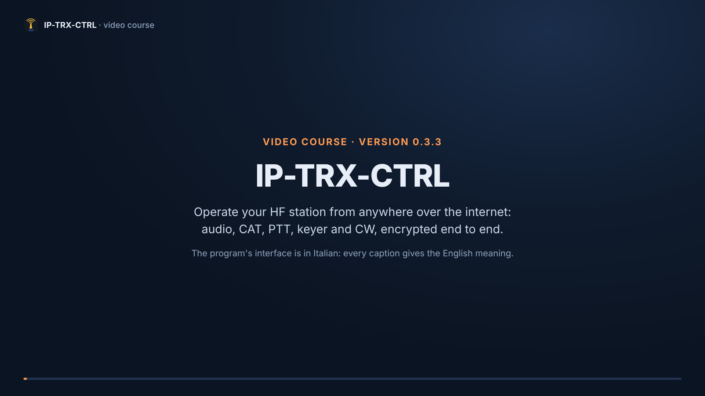

# Video course

A video course of about 13 minutes on IP-TRX-CTRL **0.3.3**, with real screenshots of the program: a server and a client paired over the internet, a simulated radio (Hamlib Dummy) and the browser page. English captions, no voice. The program's interface is in Italian: the captions give the English meaning of each label.

**[Download the video (MP4, 1920×1080)](https://raw.githubusercontent.com/ic8tem/IP-TRX-CTRL/video-corso/IP-TRX-CTRL-video-course-en.mp4)**

## Chapters

| Time | Chapter |
|---|---|
| 0:15 | How it works |
| 1:09 | Download and install |
| 1:59 | First start |
| 3:11 | Setting up the server |
| 4:55 | Pairing the two PCs |
| 6:12 | The client window |
| 8:27 | Transmitting safely |
| 9:33 | Voice keyer and CW |
| 10:43 | From a browser or phone |
| 11:52 | Make it yours |
| 12:27 | Updates and help |

The same course in other languages: [Italiano](IT-Video-corso) · [Español](ES-Videocurso) · [Français](FR-Cours-vidéo) · [Deutsch](DE-Videokurs)

---

[Contents](English) · Other languages: [Italiano](IT-Video-corso) · [Español](ES-Videocurso) · [Français](FR-Cours-vidéo) · [Deutsch](DE-Videokurs)
