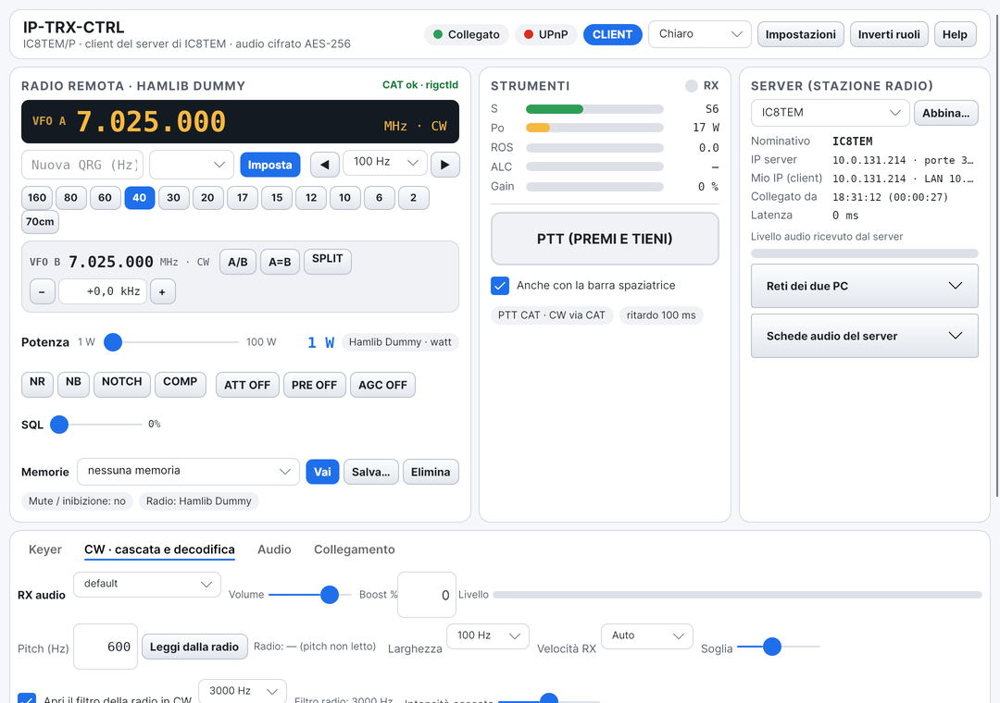

# Modo CW

Cuando la radio está en un modo CW, en lugar del recuadro de audio aparece **CW · cascata e decodificatore** (CW · cascada y decodificador). Micrófono y audio TX quedan ocultos; el audio de recepción pasa a una línea en el recuadro *Radio remota*.

## Cascada

- Espectro del audio recibido de **0 a 2000 Hz** (frecuencia en vertical, tiempo en horizontal).
- La franja del pitch (200–1000 Hz) aparece resaltada; el pitch en uso lo marcan la flecha verde y el **000** de la escala derecha (desde la 0.2.6 sin línea discontinua sobre la cascada, para no tapar las señales).
- **Escala derecha**: desplazamiento respecto al pitch en Hz, con **000** a la altura del pitch (y la flecha verde), +/− arriba y abajo.
- **Escala izquierda**: la **frecuencia real** de cada señal (MHz.kHz.Hz), calculada con la frecuencia de la radio y el pitch: en CW una señal más aguda queda por encima de la frecuencia de la radio, en CW-R por debajo. Sin la frecuencia de la radio, la escala izquierda muestra los Hz de audio.
- Al pasar el ratón por la cascada aparecen la frecuencia exacta y el desplazamiento respecto al pitch del punto indicado.
- Desde la 0.2.5 avanza 3 veces más rápido: una columna nueva cada 21 ms aproximadamente (47 por segundo), unos 14 segundos de historia a lo ancho de la cascada. Cada columna analiza 64 ms de audio, así puntos y rayas del CW se ven separados.

## Pitch

- Casilla **Pitch CW (Hz)** de **200 a 1000 Hz**.
- El servidor lee el pitch configurado en la radio (nivel Hamlib `CWPITCH`) y lo propone en la casilla; **Leggi dalla radio** (leer de la radio) lo vuelve a leer. Si se cambia la casilla, el pitch se ajusta también en la radio. Si la radio no admite el comando, vale el valor escrito a mano.

## Decodificador

- Trabaja sobre el audio recibido a 8 kHz.
- Filtro estrecho centrado en el pitch (ancho elegido de 50 a 200 Hz), umbral adaptativo sobre el ruido, medida de puntos, rayas y pausas, reconocimiento automático de la velocidad de 5 a 60 PPM.
- El texto de la señal del pitch avanza en la línea bajo la cascada, con los indicativos resaltados.
- Está escrito desde cero, sin código de otros decodificadores.

## Otras señales

- Clic en una señal **dentro** de la franja del pitch: el pitch se desplaza a esa señal.
- Clic en una señal **fuera** del pitch: se abre una **ventana de decodificación adicional**, una por señal. Muestra frecuencia, velocidad y texto, con los botones **Porta al pitch (QSY)** (mueve el VFO para que la señal caiga en el pitch), **Copia nominativo** (copiar indicativo), **Pulisci** (limpiar) y **Chiudi** (cerrar).

## Filtro de la radio e intensidad de la cascada

Con el filtro CW estrecho de la radio (normalmente 500 Hz o menos) la cascada horizontal queda casi vacía: la radio corta todo lo que está fuera del filtro. Por eso, al entrar en CW, IP-TRX-CTRL pide a la radio un **filtro ancho** (3000 Hz de serie; se puede elegir 1200, 2400, 2700, 3000 o 3600 Hz) con el comando Hamlib del ancho de banda. El filtro actual leído de la radio aparece junto a la elección. Quitando la marca de «Filtro largo» (filtro ancho) se vuelve al filtro normal de la radio.

El cursor **Intensità** (intensidad) desplaza la escala de colores de la cascada: hacia la izquierda el ruido se oscurece y las señales destacan, hacia la derecha se ven también las señales más débiles.

---

[Índice](Español) · Otros idiomas: [Italiano](IT-Modo-CW) · [English](EN-CW-mode) · [Français](FR-Mode-CW) · [Deutsch](DE-CW-Betrieb)
