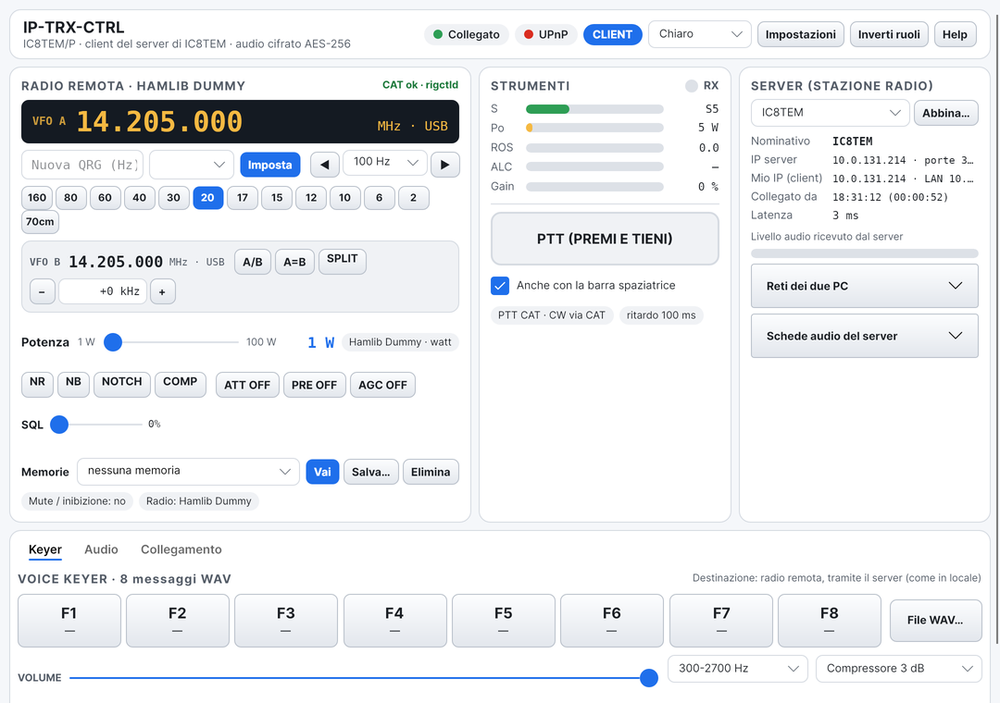
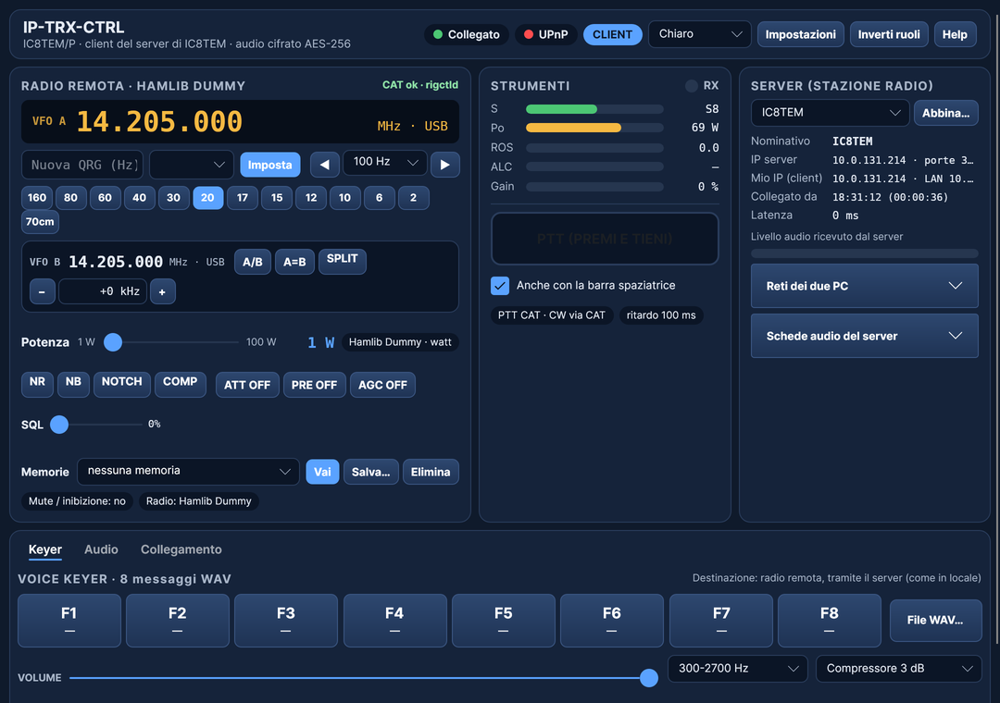
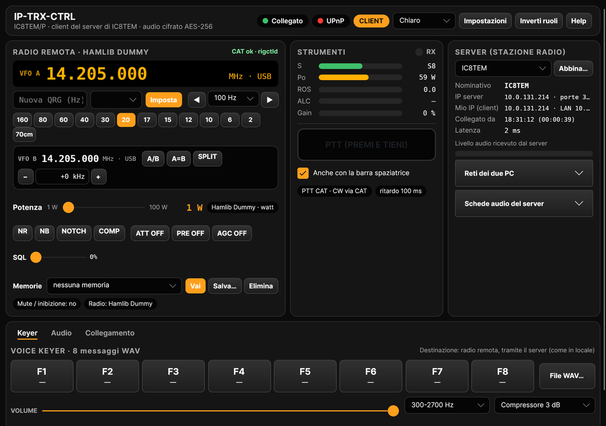
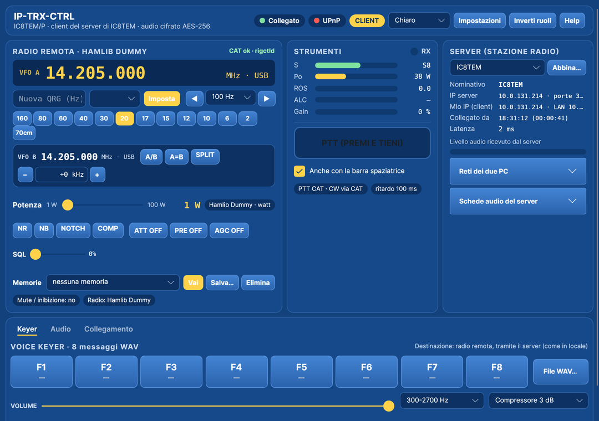
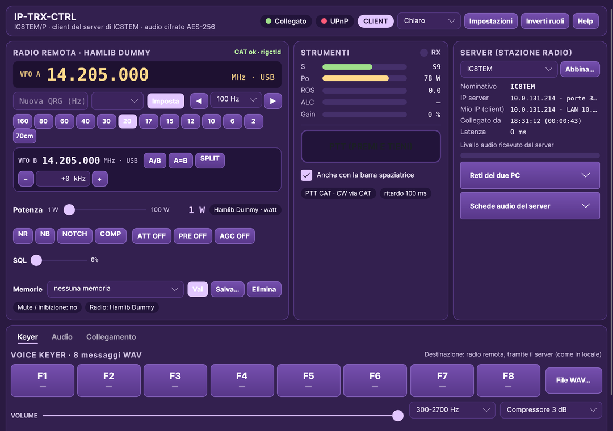
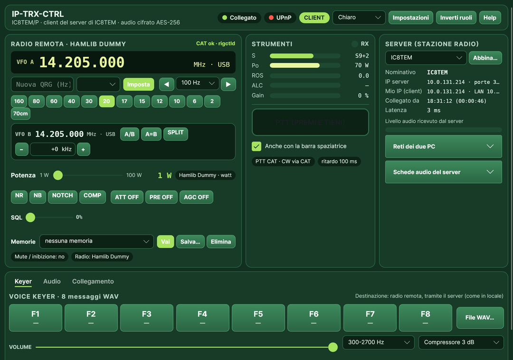

# Temas de color

Seis temas, elegidos en el menú de colores de la parte superior de la ventana principal. Las imágenes son capturas reales del cliente conectado a un servidor.

## Chiaro (claro)

## Notte (noche)

## Nero (negro)

## Blu (azul)

## Viola (violeta)

## Verde (verde)

---

[Índice](Español) · Otros idiomas: [Italiano](IT-Temi-di-colore) · [English](EN-Colour-themes) · [Français](FR-Thèmes-de-couleur) · [Deutsch](DE-Farbthemen)
