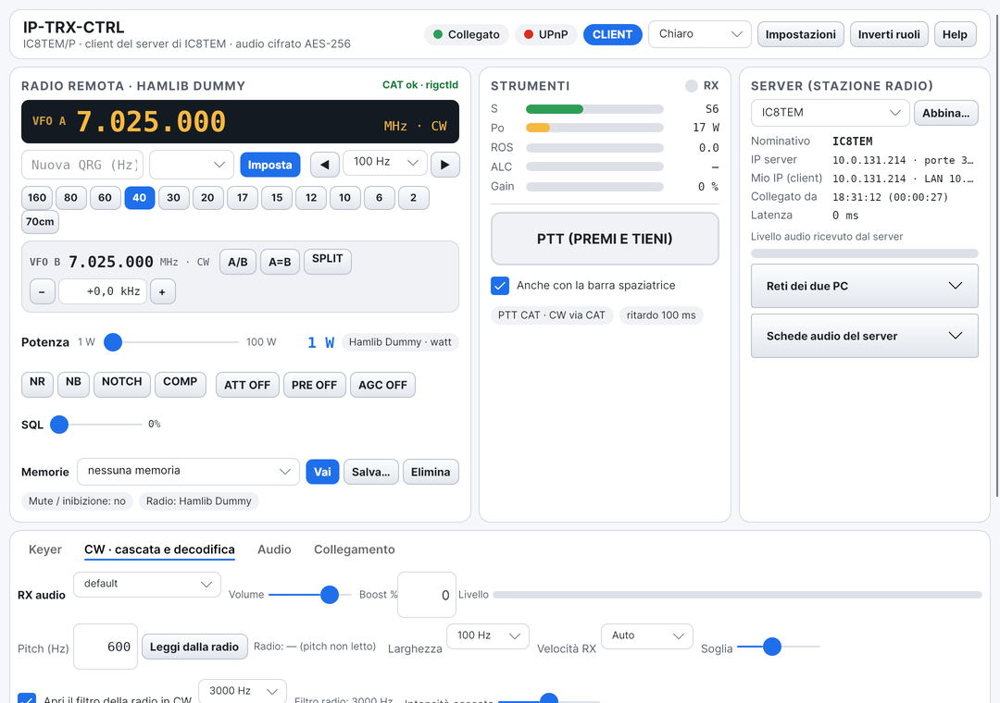

# Mode CW

Quand la radio est dans un mode CW, **CW · cascata e decodificatore** (CW · cascade et décodeur) apparaît à la place du cadre audio. Micro et audio TX sont masqués ; l'audio de réception passe sur une ligne dans le cadre *Radio remota* (radio distante).

## Cascade

- Spectre de l'audio reçu de **0 à 2000 Hz** (fréquence à la verticale, temps à l'horizontale).
- La bande du pitch (200–1000 Hz) est mise en évidence ; le pitch utilisé est marqué par la flèche verte et par le **000** de l'échelle de droite (depuis la 0.2.6 sans ligne pointillée sur la cascade, pour ne pas couvrir les signaux).
- **Échelle de droite** : écart par rapport au pitch en Hz, avec **000** à la hauteur du pitch (et la flèche verte), +/− au-dessus et au-dessous.
- **Échelle de gauche** : la **fréquence réelle** de chaque signal (MHz.kHz.Hz), calculée à partir de la fréquence de la radio et du pitch : en CW un signal plus aigu se trouve au-dessus de la fréquence de la radio, en CW-R au-dessous. Sans la fréquence de la radio, l'échelle de gauche affiche les Hz audio.
- En passant la souris sur la cascade apparaissent la fréquence exacte et l'écart au pitch du point pointé.
- Depuis la 0.2.5 elle défile 3 fois plus vite : une nouvelle colonne toutes les 21 ms environ (47 par seconde), soit environ 14 secondes d'historique sur la largeur de la cascade. Chaque colonne analyse 64 ms d'audio, si bien que points et traits du CW se voient séparés.

## Pitch

- Case **Pitch CW (Hz)** de **200 à 1000 Hz**.
- Le serveur lit le pitch réglé sur la radio (niveau Hamlib `CWPITCH`) et le propose dans la case ; **Leggi dalla radio** (lire depuis la radio) le relit. Si l'on modifie la case, le pitch est aussi réglé sur la radio. Si la radio ne prend pas la commande, la valeur saisie à la main s'applique.

## Décodeur

- Il travaille sur l'audio reçu à 8 kHz.
- Filtre étroit centré sur le pitch (largeur choisie de 50 à 200 Hz), seuil adaptatif sur le bruit, mesure des points, traits et pauses, reconnaissance automatique de la vitesse de 5 à 60 mots/min.
- Le texte du signal sur le pitch défile dans la ligne sous la cascade, avec les indicatifs mis en évidence.
- Il est écrit de zéro, sans code d'autres décodeurs.

## Autres signaux

- Clic sur un signal **dans** la bande du pitch : le pitch se déplace sur ce signal.
- Clic sur un signal **hors** du pitch : une **fenêtre de décodage supplémentaire** s'ouvre, une par signal. Elle affiche fréquence, vitesse et texte, avec les boutons **Porta al pitch (QSY)** (déplacer le VFO pour que le signal tombe sur le pitch), **Copia nominativo** (copier l'indicatif), **Pulisci** (effacer) et **Chiudi** (fermer).

## Filtre de la radio et intensité de la cascade

Avec le filtre CW étroit de la radio (en général 500 Hz ou moins), la cascade horizontale reste presque vide : la radio coupe tout ce qui est hors du filtre. C'est pourquoi, en passant en CW, IP-TRX-CTRL demande à la radio un **filtre large** (3000 Hz par défaut ; au choix 1200, 2400, 2700, 3000 ou 3600 Hz) avec la commande Hamlib de largeur de bande. Le filtre actuel lu sur la radio apparaît à côté du choix. En décochant «Filtro largo» (filtre large), on revient au filtre normal de la radio.

Le curseur **Intensità** (intensité) déplace l'échelle de couleurs de la cascade : vers la gauche le bruit s'assombrit et les signaux ressortent, vers la droite on voit aussi les signaux les plus faibles.

---

[Sommaire](Français) · Autres langues: [Italiano](IT-Modo-CW) · [English](EN-CW-mode) · [Español](ES-Modo-CW) · [Deutsch](DE-CW-Betrieb)
