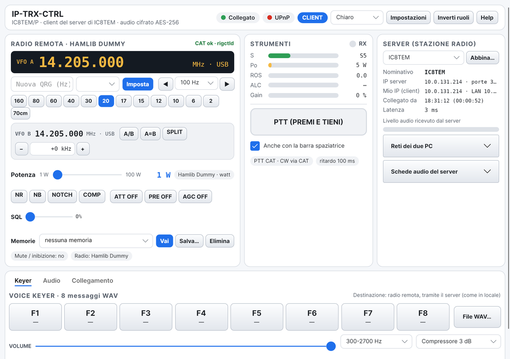
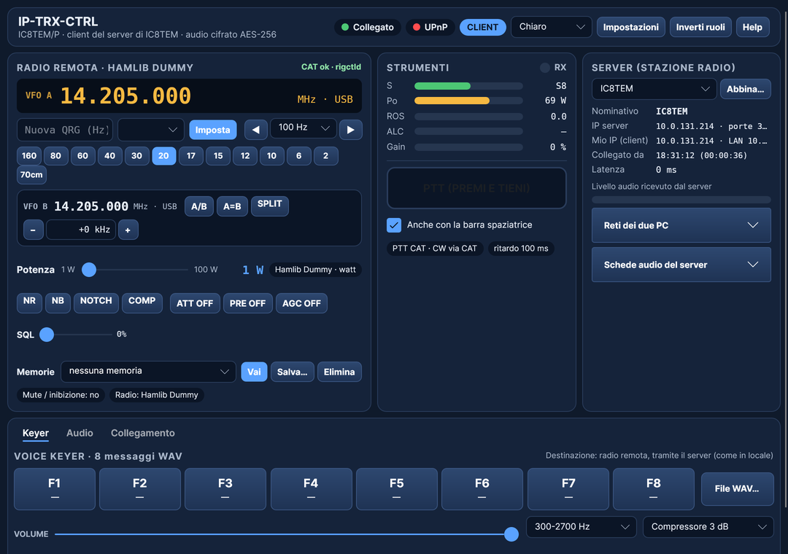
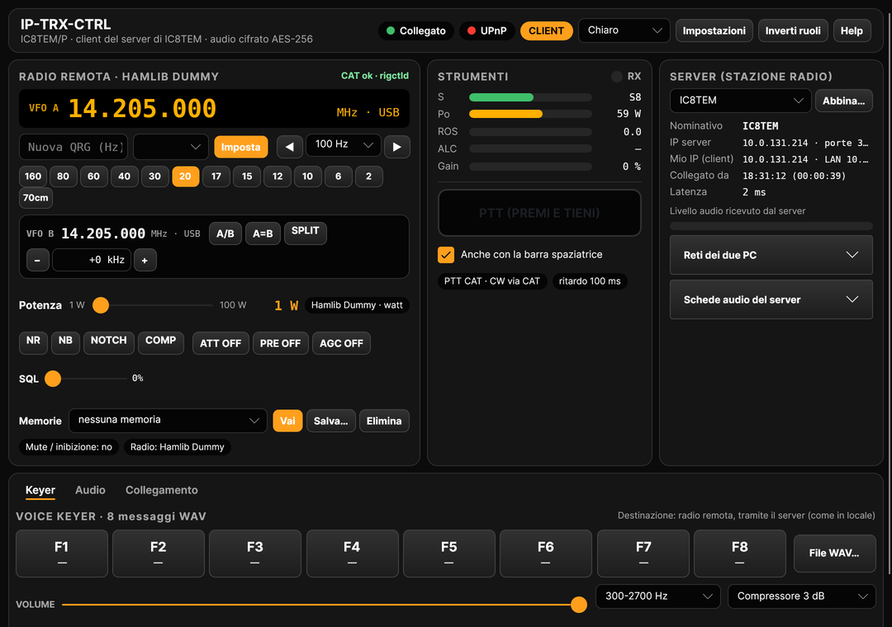
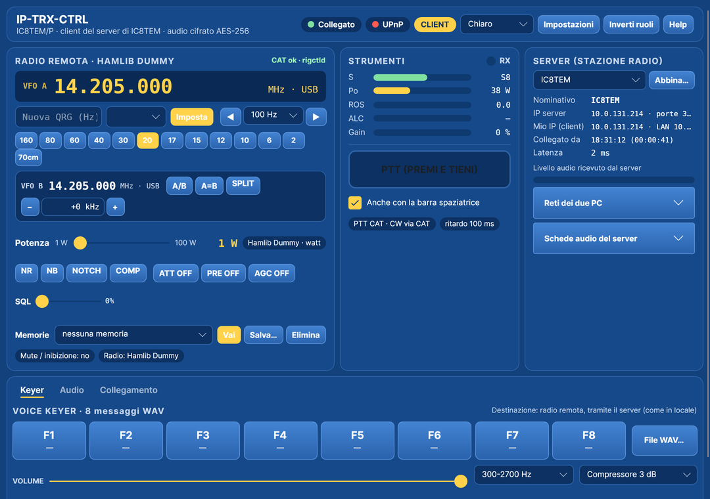
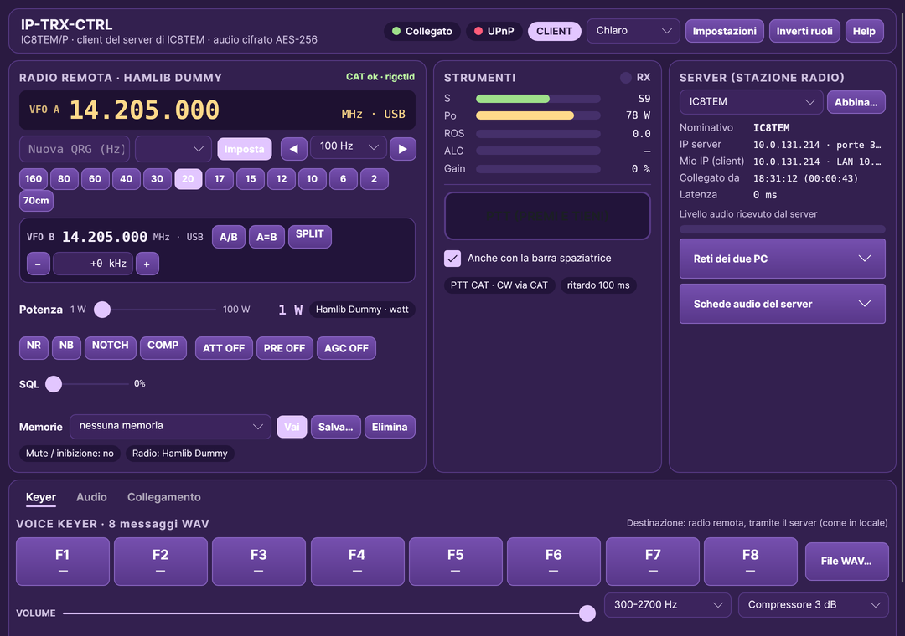
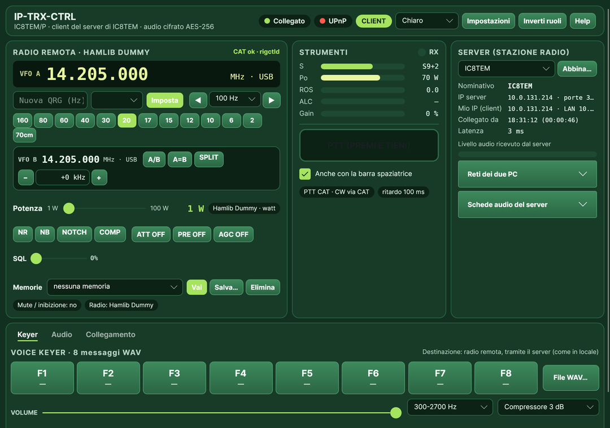

# Thèmes de couleur

Six thèmes, choisis dans le menu des couleurs en haut de la fenêtre principale. Les images sont de vraies captures du client connecté à un serveur.

## Chiaro (clair)

## Notte (nuit)

## Nero (noir)

## Blu (bleu)

## Viola (violet)

## Verde (vert)

---

[Sommaire](Français) · Autres langues: [Italiano](IT-Temi-di-colore) · [English](EN-Colour-themes) · [Español](ES-Temas-de-color) · [Deutsch](DE-Farbthemen)
