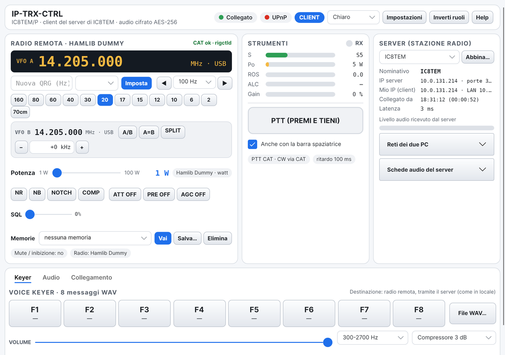
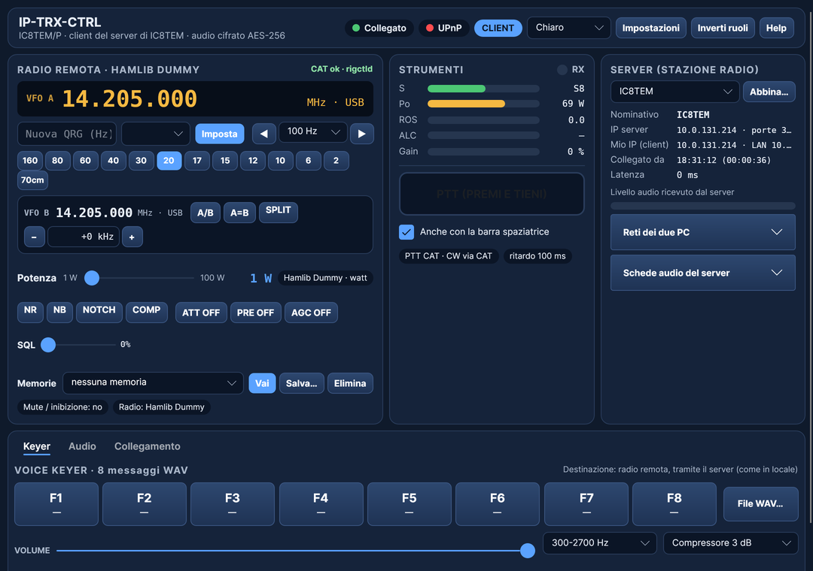
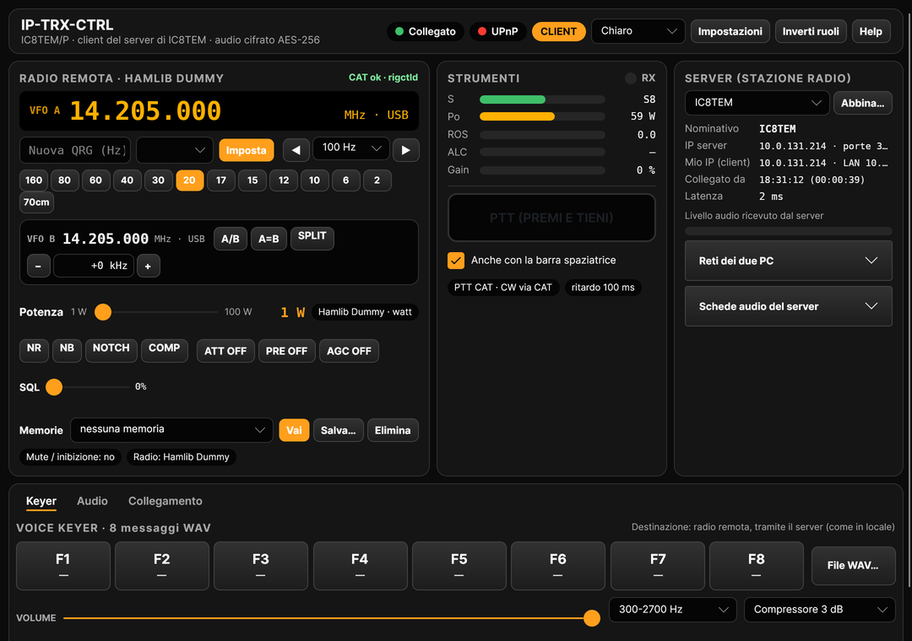
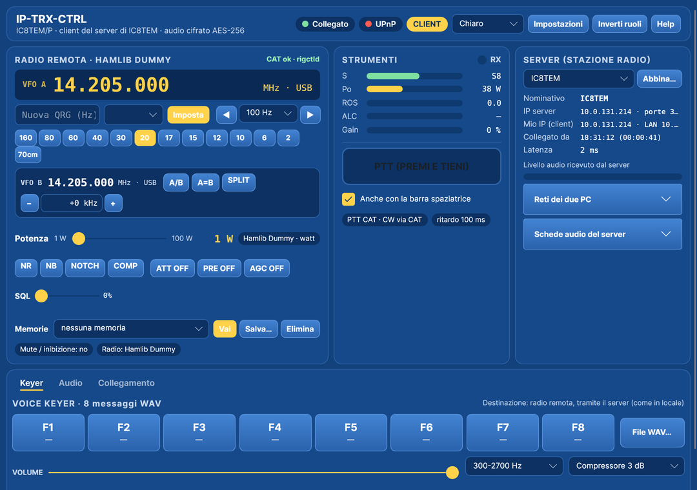
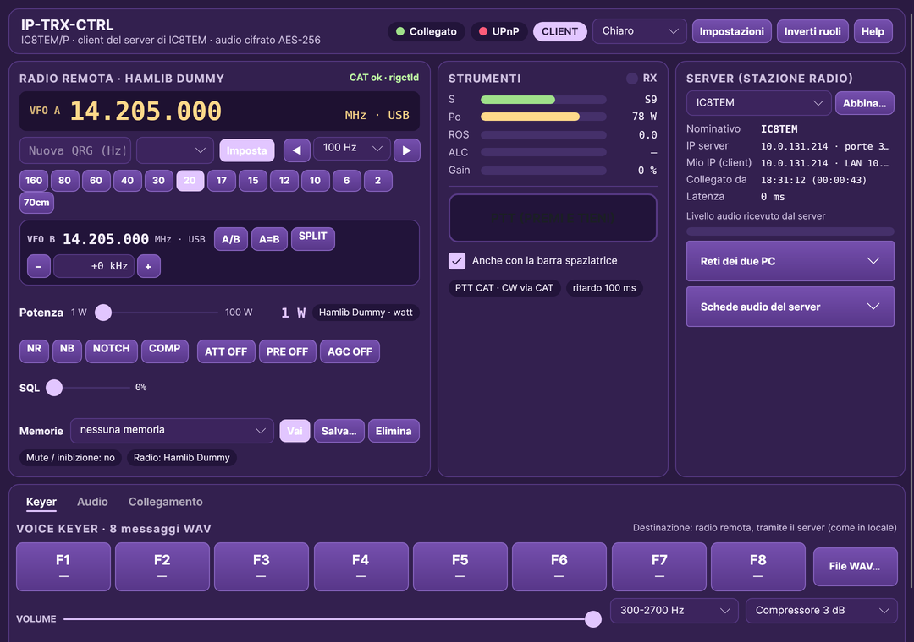
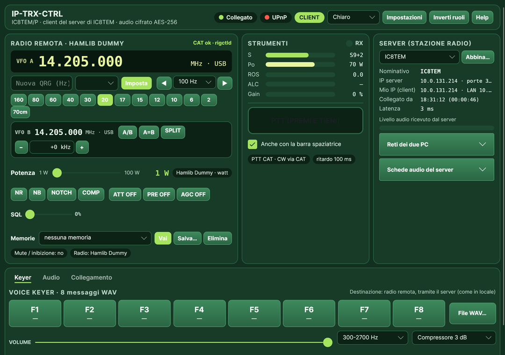

# Temi di colore

Sei temi, scelti dal menu **Colori** in alto nella finestra principale. Le immagini sono schermate vere del client collegato a un server.

## Chiaro

## Notte

## Nero

## Blu

## Viola

## Verde

---

[Indice](Italiano) · Altre lingue: [English](EN-Colour-themes) · [Español](ES-Temas-de-color) · [Français](FR-Thèmes-de-couleur) · [Deutsch](DE-Farbthemen)
