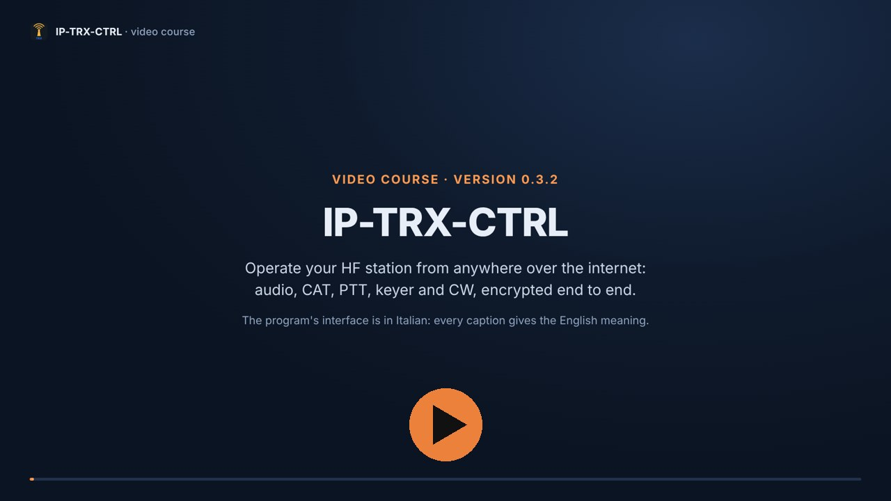

# Video course (English)

A 13-minute course on IP-TRX-CTRL **0.3.2**, made with real screenshots of the program: a server and a client paired over the internet, a simulated radio (Hamlib Dummy) and the browser page. The program's interface is in Italian: every caption gives the English meaning of the labels.

**[Download the video (MP4, 1920×1080, 28 MB)](https://raw.githubusercontent.com/ic8tem/IP-TRX-CTRL/video-corso/IP-TRX-CTRL-video-course-en.mp4)** · captions only, no voice.

## Chapters

| Time | Chapter | What you see |
|---|---|---|
| 0:15 | How it works | Server at the radio, client at the operator, MQTT broker only to meet, optional browser page |
| 1:09 | Download and install | Which file for Windows, Linux, Raspberry Pi, macOS; Hamlib and the serial port |
| 1:59 | First start | Choosing the role, callsign, radio model, the amateur-radio declaration |
| 3:11 | Setting up the server | Radio settings, SWR protection, transmit safety, clients and the fixed code |
| 4:55 | Pairing the two PCs | The 10-digit number on the server, typing it on the client, the list of servers |
| 6:12 | The client window | Frequency, bands, step, VFO B and split, power, radio controls, memories, meters, PTT |
| 8:27 | Transmitting safely | What the client and the server show in TX; timeout, no QSY in TX, local priority |
| 9:33 | Voice keyer and CW | F1–F8 WAV messages, CW tab with waterfall and decoder, CW macros |
| 10:43 | From a browser or phone | Turning on browser access, logging in with the fixed code, PC and phone pages |
| 11:52 | Make it yours | Colour themes, hiding parts of the main window |
| 12:27 | Updates and help | Automatic updates (not for .deb, .rpm, Arch, Slackware), built-in help, problem report |

## Labels used in the video

| Italian | English |
|---|---|
| Impostazioni | Settings |
| Inverti ruoli | Swap roles |
| Abbinamento · Abbina | Pairing · Pair |
| Collegato | Connected |
| Nuova QRG · Imposta | New frequency · Set |
| Passo | Tuning step |
| Potenza | TX power |
| Memorie | Memories |
| Strumenti | Meters |
| PTT (premi e tieni) | PTT (press and hold) |
| Protezione ROS | SWR protection |
| Tempo massimo di una trasmissione | TX timeout |
| Codice fisso del server | Server's fixed code |
| Accesso dal browser | Browser access |
| Rapporto per un problema | Problem report |

The full manuals (in Italian) are in the repository's [docs folder](https://github.com/ic8tem/IP-TRX-CTRL/tree/main/docs). Downloads are on the [Releases page](https://github.com/ic8tem/IP-TRX-CTRL/releases/latest).
